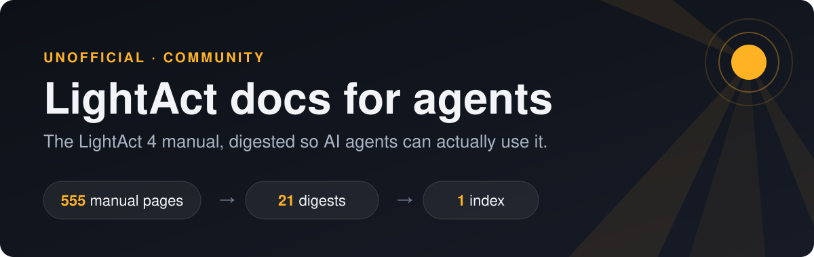
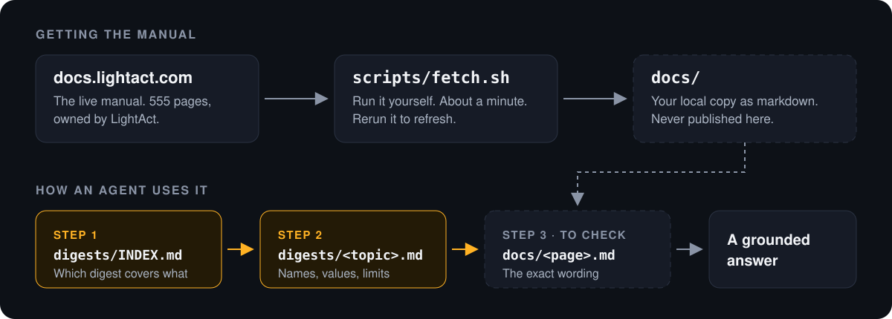

<p align="center">
  
</p>

An AI agent can only help with [LightAct](https://lightact.com) as far as it knows LightAct. The LightAct 4 manual is 555 pages, which is a lot to read every time someone asks a question, and without it an agent can only guess.

This repository gives an agent a short way into the whole manual:

- **21 digests**, one per section of the manual, written for an agent that has to program LightAct, build against its API, or design a content pipeline around it.
- **One index** that says which digest answers which kind of question.
- **One script** that copies the live manual to your machine as markdown, so the agent can check the exact wording.

> [!IMPORTANT]
> This is an unofficial community project. It is not made by, endorsed by or affiliated with LightAct. The manual itself is LightAct's and is **not** stored here. The script fetches it from [docs.lightact.com](https://docs.lightact.com) onto your own machine. The digests are detailed summaries of what the manual says, some of them close to the length of the pages they cover. If LightAct would rather any of this was not public, it will be taken down.

## How it works

<p align="center">
  
</p>

The digests carry the facts an agent needs most: exact names of windows, variables, nodes and settings, values and limits, file naming rules, shortcuts, OSC and DMX addresses, and the warnings the manual marks as "Good to know". Every digest entry names the manual page it came from, so the agent can open that page when a detail matters.

## Quick start

```sh
git clone https://github.com/sbavila/lightact-agent-docs.git
cd lightact-agent-docs
./scripts/fetch.sh        # copies the manual into docs/, about a minute
```

Then tell your agent where it is. Add this to your project's `AGENTS.md`, `CLAUDE.md` or equivalent:

```md
## LightAct
Before answering anything about LightAct, read ~/path/to/lightact-agent-docs/AGENTS.md
and follow it. Do not answer LightAct questions from memory.
```

That is all. [`AGENTS.md`](AGENTS.md) tells the agent to read the index, then the right digest, then the manual page.

The digests work without running the script. You only lose step 3, the check against the exact wording.

## Skills

If your agent supports skills, install one and it will reach for the digests by itself whenever LightAct comes up. Run these from the root of your clone.

**Claude Code** ([skill](skills/claude/lightact/SKILL.md))

```sh
mkdir -p ~/.claude/skills
ln -s "$(pwd -P)/skills/claude/lightact" ~/.claude/skills/lightact
```

**Codex** ([skill](skills/codex/lightact/SKILL.md), written by Codex for itself; [more install options](skills/codex/README.md))

```sh
mkdir -p ~/.agents/skills
ln -s "$(pwd -P)/skills/codex/lightact" ~/.agents/skills/lightact
```

Both are links back into your clone, so the skill, the digests and the manual copy stay together. Keep the clone where it is, or remake the link if you move it.

## What you can ask once it is set up

- "Which API calls do I need to create a video layer at 01:02:10 and point it at this asset?"
- "How does LightAct decide which version of a file to play, and what should our files be called?"
- "What does a Secondary play when a layer is not assigned to it?"
- "List every variable on the Video layer template."
- "What changed for cues and crossfades between 4.13 and 4.17?"
- "What OSC address triggers a cue, and why is mine being ignored?"

## What is covered

| Manual section | Pages | Digest |
|---|---:|---|
| LightAct API (4.18+) | 1 | [api.md](digests/api.md) |
| Assets: formats, codecs, ingestion, versioning | 7 | [assets.md](digests/assets.md) |
| Timelines: sections, markers, cue list, timecode | 5 | [timelines.md](digests/timelines.md) |
| Layers and layouts: templates, variables, nodes, fades | 58 | [layers-and-layouts.md](digests/layers-and-layouts.md) |
| Node reference | 316 | [node-reference.md](digests/node-reference.md) |
| Video playback: buffering, proxies, performance | 7 | [video-playback.md](digests/video-playback.md) |
| Real-time content: Notch, Unreal, TouchDesigner | 17 | [real-time-content-playback.md](digests/real-time-content-playback.md) |
| Content mapping: canvases, throwers | 3 | [content-mapping.md](digests/content-mapping.md) |
| Output setup | 11 | [output-setup.md](digests/output-setup.md) |
| Projection mapping | 14 | [projection-mapping.md](digests/projection-mapping.md) |
| DMX | 12 | [dmx.md](digests/dmx.md) |
| OSC and MIDI | 5 | [osc-and-midi.md](digests/osc-and-midi.md) |
| Integrations: audio, network, tracking, capture | 24 | [integrations.md](digests/integrations.md) |
| LightNet: multi-server clusters | 8 | [lightnet.md](digests/lightnet.md) |
| LightTrack | 3 | [lighttrack.md](digests/lighttrack.md) |
| Hardware preparation | 6 | [preparing-your-hardware-for-lightact.md](digests/preparing-your-hardware-for-lightact.md) |
| Licensing | 4 | [licensing.md](digests/licensing.md) |
| Quick start, interface, shortcuts | 10 | [quick-start.md](digests/quick-start.md) |
| Coming from disguise or Pixera | 7 | [transitioning-to-lightact-from-other-media-servers.md](digests/transitioning-to-lightact-from-other-media-servers.md) |
| Launch arguments, WebUI | 2 | [miscellaneous.md](digests/miscellaneous.md) |
| Release changelogs, 4.13 to 4.17 | 34 | [release-changelogs.md](digests/release-changelogs.md) |

Start with [digests/INDEX.md](digests/INDEX.md).

## Staying current

The manual changes over time, so everything here carries a date.

- [`FETCHED`](FETCHED) holds the date the digests were last checked against the live manual.
- [`manifest.sha256`](manifest.sha256) holds a checksum for every manual page at that date. After you run `scripts/fetch.sh`, `git diff manifest.sha256` shows exactly which pages have changed since the digests were written.
- The digests are refreshed monthly. Sections whose pages changed are re-read in full and rewritten.

If you are working against a release newer than the `FETCHED` date, run the script and have your agent read the changed pages directly.

## Do you need this?

Maybe not. We tested it on three questions that each need facts from two or three manual pages, asked of the same model three ways:

| Agent had | Result |
|---|---|
| Nothing: no web, no digests | Could only guess, and said so |
| Web access, no digests | All three right. It read 24 pages of the live manual and searched all 34 changelog pages to get there |
| The skill and digests, no web | All three right, from 20 local files |

So an agent that has web access and takes the trouble to read the live manual does just as well. What this repository adds is that the agent does not need the web, does not need to crawl, and is told to look before it answers. Three questions is a small test; treat it as an indication.

## How far to trust it

The digests were written by AI agents that read every page in full, under [this brief](scripts/digest-brief.md): keep exact names and values, never infer, and flag anything vague or contradictory with a line starting `Unclear:`.

They are still summaries. Treat the manual as the authority and the digests as the way to find the right page quickly. If a digest is wrong, please open an issue or a pull request with the manual page that shows it.

## Verification

The digests were written by AI agents, so every statement in them is checked against the manual page it cites. [`scripts/verify-digests.py`](scripts/verify-digests.py) reads each digest, pairs every line with the page named under its heading, and asks [TypeSafe](https://typesafe.ai)'s Jev model one question per line: does the page support this, contradict it, or not mention it? Any answer other than a confident "supports" is flagged for a person or an agent to read against the page.

The last run is in [`verification/report.md`](verification/report.md). On 18 November 2026 it checked 1,880 statements: 1,720 were supported and 160 were flagged. Every flagged line was then read against its page. Six lines were wrong or said more than the page does, and were corrected. The rest were right, and are listed in the report with a reviewer's note.

What the check does not prove:

- That the digests are complete. It checks what a digest says, not what it leaves out.
- That a supported line is right. The model can miss an error, most often a changed number in a long list. In a test with 206 deliberately wrong lines it caught 202.
- That the manual is right. A line that repeats a mistake in the manual passes.
- Anything about lines with no single page to check against: the opening summaries, the closing "For automation and pipelines" sections and the lines starting `Unclear:`.

To run it you need the manual copy (`scripts/fetch.sh`), Python 3 and a TypeSafe API key in the `TYPESAFE_API_KEY` environment variable. Nothing has to be installed.

```sh
python3 scripts/verify-digests.py --dry-run         # shows the plan and a token estimate, sends nothing
python3 scripts/verify-digests.py --digest assets   # checks one digest and prints its flags
python3 scripts/verify-digests.py                   # checks everything, writes verification/report.md
python3 -m unittest discover -s tests               # the script's own tests, no key needed
```

A full run from nothing is about 520 requests and one million input tokens, a few US cents at the time of writing. Answers are kept in `verification/cache.json`, so later runs only pay for lines or pages that changed. When you have read a flagged line and the digest is right, add its key and a short note to `verification/reviewed.json`. It then stays out of the to-read list until the line or its page changes.

## What is not here

- **The manual.** It belongs to LightAct. Read it at [docs.lightact.com](https://docs.lightact.com).
- **Anything the manual does not say.** For example, the plugin packaging format for the 4.18 API was not documented at the time of writing.
- **Support.** For help with LightAct itself, use LightAct's own [support channels](https://docs.lightact.com/quick-start/asking-for-support).

## Licence

Scripts and digests are under the [MIT licence](LICENSE). LightAct and the LightAct documentation are the property of LightAct.
